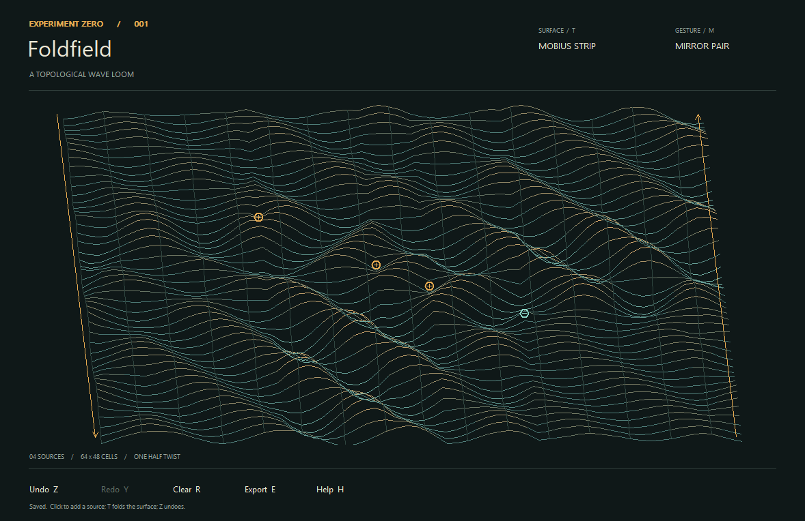

# Foldfield

A native mathematical instrument for weaving interference fields on an open sheet, a cylinder, or a Mobius strip. Place signed sources, fold the surface, and compare the resulting graph-distance waves. Gesture handlers create single, mirrored, or opposing pairs. Undo and redo make the exploration reversible.

**[Download the Windows build](https://github.com/wolfbreed1829/foldfield/releases/tag/v0.1.0)** · [User guide](docs/USER_GUIDE.md) · [How it works](docs/ARCHITECTURE.md)



This is a Windows application. Download and extract the release to run it; the repository page is its shareable home.

## Run

Extract `Foldfield-windows-x64.zip` into a writable folder, then open `Foldfield/Foldfield.exe`. Keep its companion files together. Windows 11 x64 is the verified platform. No language compiler, Python, browser, or network connection is required to use it.

Left click adds a positive source; right click adds a negative source. **T** changes topology; **M** changes the gesture rule; **Z/Y** undo/redo; **R** clears; **E** exports a bitmap; **H** opens help. Current sources, topology, and rule are saved beside the executable. Start with the empty sheet; no demonstration records are supplied.

## Build and verify

Install the pinned toolchains described in [docs/BUILD.md](docs/BUILD.md), then run:

```powershell
.\scripts\build.ps1 -Tests
.\scripts\package.ps1
```

Pony computes isolated source geodesics, Koka owns the application and effect handlers, and Uiua computes the interference array. A C adapter provides Win32 drawing, events, process launch, and filesystem access. Source lives in `src/`; standalone experiments live in `probes/`.

See [the user guide](docs/USER_GUIDE.md), [architecture](docs/ARCHITECTURE.md), [test evidence](docs/TESTS.md), and [limitations](docs/LIMITATIONS.md). The work is an experimental mathematical instrument, not a physical wave simulation.
